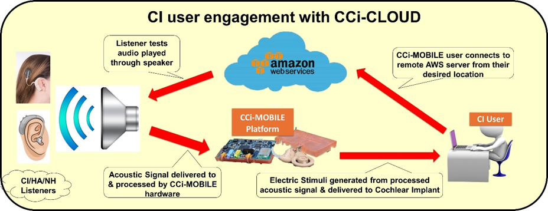
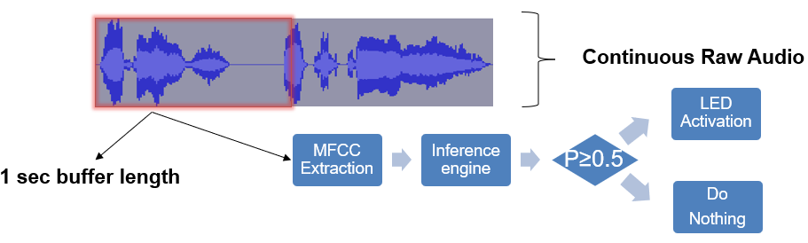

I build and test speech processing systems for people with hearing loss, across embedded hardware, cloud platforms, and machine learning, and I keep real listeners in the loop. I work in the Cochlear Implant Lab at UT Dallas's Center for Robust Speech Systems.

Making unfamiliar voices easier to understand
------
**The question.** Cochlear implants deliver only a coarse version of speech, so understanding a new voice, especially in noise, is hard. Listeners generally understand voices they know better than voices they don't. Can that familiarity advantage be engineered, so that an unfamiliar talker becomes easier to understand?

**The approach.** I work on a "speaker-in-the-loop" approach in two stages. First, I measured the natural familiarity advantage: cochlear implant users and normal-hearing listeners heard sentences spoken by well-known public figures and by unknown talkers, in quiet and in noise. Second, I used deep-learning voice conversion (StarGANv2-VC) to re-voice unfamiliar sentences in the familiar voices, then measured word recognition with the same listeners. To prepare the training data, I built a speaker-verification pipeline (ECAPA-TDNN embeddings) that keeps only clean, single-speaker audio for each target voice. I evaluate the converted speech two ways: with listeners, and with objective measures (STOI and log-spectral distance) that show where measured quality and what listeners actually understand part ways.

**What we found.** Familiar voices helped: for cochlear implant users, recognizable voices held up better than an unknown voice, especially in noise. Voice conversion helped for some target voices but not others. It raised word recognition for 5 of 12 target voices, by up to 8 percentage points, and lowered it for others. The difference traced back to each target speaker's own acoustic traits, which points to a trade-off between keeping a voice's identity and keeping the cues an implant depends on.

**Status.** Accepted to the IEEE Spoken Language Technology Workshop (SLT 2026); earlier stages presented at the Conference on Implantable Auditory Prostheses (CIAP 2025). Ongoing work looks at how far a voice should be converted and at making these systems work for more talkers.

Testing with listeners beyond the lab
------

**The question.** Most cochlear implant listening studies require people to travel to a lab, which limits who can take part and how often. Can these experiments run reliably from wherever the participant is?

**The approach.** As part of the NIH-funded CCi-MOBILE project, I built CCi-CLOUD, which runs listening experiments on Amazon Web Services. A participant connects to a remote test session from their own location; the test audio is processed by the CCi-MOBILE research platform and delivered to their implant as electric stimulation. I validated the platform by comparing remote results against conventional sound-booth testing with normal-hearing and cochlear implant listeners.

**Status.** Presented at CIAP 2023; journal manuscript submitted to *Cochlear Implants International*.

Speech technology on small devices
------
<figure style="margin: 0.5em 0 1em;">

<figcaption style="font-size:0.8em;">Deployment pipeline on the Raspberry Pi. From H. Younis and J. H. L. Hansen, IEEE WF-IoT 2021. © 2021 IEEE.</figcaption>
</figure>

**The question.** How well can voice commands be recognized in real time on a small, low-power device, and what does it cost in accuracy?

**The approach.** On a Texas Instruments–sponsored project, I trained standard and depthwise-separable convolutional networks (CNN and DS-CNN) on the Google Speech Commands dataset and deployed them on a Raspberry Pi with a four-microphone array, using TensorFlow Lite with on-device feature extraction. The models reached about 95% accuracy offline, and the deployed system ran in real time under tight memory and compute limits.

**Status.** Published at IEEE WF-IoT 2021. [Code on GitHub](https://github.com/Hazem-AF-Younis/wfiot2021-embedded-command-recognition).

Methods I use
------
* **Speech and audio ML:** PyTorch, voice conversion (StarGANv2-VC), speaker verification (ECAPA-TDNN), self-supervised speech models (HuBERT, WavLM), TensorFlow Lite
* **Listener studies:** blinded listening tests, word-level scoring, vocoded simulations of cochlear implant hearing, mixed-effects and ANOVA analysis
* **Objective evaluation:** STOI, log-spectral distance, mel-cepstral distortion, F0 analysis, Praat
* **Systems:** AWS cloud platforms, Raspberry Pi and embedded deployment, MATLAB, Python

Undergraduate mentoring
------
I design research projects that undergraduates can own. This fall I am supervising a sophomore's project on slowing instructional speech for older cochlear implant listeners while keeping lip movements in sync. Earlier, I mentored a senior design team that built a mobile app for crowdsourcing audio data.

Design projects
------
* **Microcoded CPU:** an 8-bit CPU with microsequencer control, built on a four-person team in Verilog and demonstrated on an Altera DE2 FPGA board.
* **FPGA video game:** a maze-chase game on an Altera DE2 board with 640×480 VGA output, written in VHDL and Verilog.
* **Hardware/software co-design:** greatest common divisor, Ackermann, and k-nearest-neighbor designs built with high-level synthesis on a Zynq FPGA board, comparing hardware and software timing.
